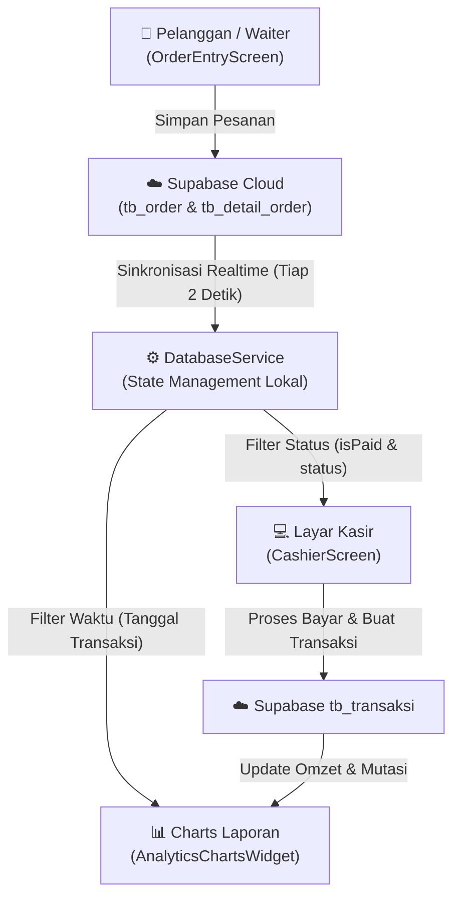
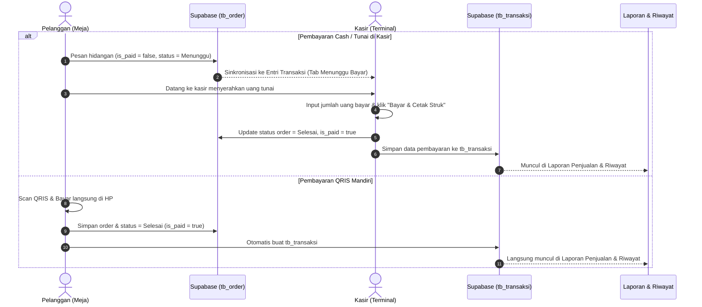
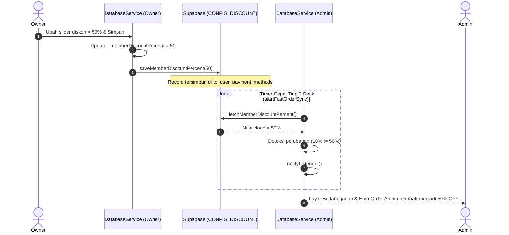

# PANDUAN LENGKAP ARSITEKTUR & ALUR SISTEM FILTER RASANTARA
**Dokumentasi Teknis UJIKOM Kejuruan Rekayasa Perangkat Lunak (RPL)**  
*Aplikasi Kasir & Pemesanan Meja Restoran (Table Service) Berbasis Flutter & Cloud Supabase*

---

## DAFTAR ISI
1. [Gambaran Umum Arsitektur Data](#1-gambaran-umum-arsitektur-data)
2. [Alur 1: Sistem Filter Status Kasir (Lunas vs Belum Lunas)](#2-alur-1-sistem-filter-status-kasir-lunas-vs-belum-lunas)
3. [Alur 2: Sistem Filter Waktu pada Charts Laporan (Mingguan, Bulanan, Tahunan)](#3-alur-2-sistem-filter-waktu-pada-charts-laporan-mingguan-bulanan-tahunan)
4. [Alur 3: Sinkronisasi Diskon Member VIP (Owner ↔ Admin)](#4-alur-3-sinkronisasi-diskon-member-vip-owner--admin)
5. [Tabel Pemetaan Kode & File Terkait](#5-tabel-pemetaan-kode--file-terkait)

---

## 1. GAMBARAN UMUM ARSITEKTUR DATA

Aplikasi Rasantara menggunakan konsep **Single Source of Truth** yang berpusat pada database cloud **Supabase (PostgreSQL)** dan dikelola oleh **`DatabaseService`** (*State Management ChangeNotifier*).



---

## 2. ALUR 1: SISTEM FILTER STATUS KASIR (LUNAS VS BELUM LUNAS)

### A. Mengapa Pesanan Tunai Masuk ke "Menunggu Bayar" dan Belum Masuk Laporan?
Dalam standar operasional restoran (*Table Service*):
* **Pembayaran QRIS Mandiri:** Pelanggan langsung membayar dari smartphone masing-masing. Saat pembayaran diverifikasi oleh sistem, pesanan langsung berstatus **Lunas (`isPaid: true`)** dan data transaksi langsung dicatat ke `tb_transaksi`, sehingga langsung muncul di **Laporan Penjualan**.
* **Pembayaran Cash/Tunai:** Pelanggan belum menyerahkan uang ke kasir. Oleh karena itu, pesanan berstatus **Belum Lunas (`isPaid: false`)** dan status pesanan adalah **Menunggu (`OrderStatus.menunggu`)**.
* Pesanan tunai ini **masuk ke terminal kasir (Entri Transaksi)** pada tab **"Menunggu Bayar"**. Pesanan baru resmi masuk ke Laporan setelah kasir menerima uang fisik dan menekan tombol **"Bayar & Cetak Struk"**.

### B. Diagram Alur Transaksi Kasir


### C. Logika Filter pada Kode (`lib/screens/cashier/cashier_screen.dart`)
Pada baris 370–385:
```dart
// 1. Ambil pesanan yang belum selesai dan belum dibatalkan
final activeOrders = widget.db.orders
    .where((o) => o.status != OrderStatus.selesai && o.status != OrderStatus.dibatalkan)
    .toList();

// 2. Filter Tagihan Belum Lunas (Tab "Menunggu Bayar")
final unpaidOrders = activeOrders
    .where((o) => !o.isPaid || o.status == OrderStatus.menunggu)
    .toList();

// 3. Filter Pesanan Lunas yang Masuk Dapur (Tab "Sedang Dimasak")
final cookingOrders = activeOrders
    .where((o) => o.isPaid || o.status == OrderStatus.diproses)
    .toList();
```

---

## 3. ALUR 2: SISTEM FILTER WAKTU PADA CHARTS LAPORAN (MINGGUAN, BULANAN, TAHUNAN)

Fitur grafik analitik penghasilan terdapat pada file [lib/widgets/analytics_charts.dart](file:///Users/pplgsmkbn666/Documents/UJIKOM-COKKK/lib/widgets/analytics_charts.dart).

Sumber data agregasi berasal dari daftar seluruh transaksi yang sah di database:  
`final transactions = widget.db.transactions;`

### A. Filter Mingguan (`RevenuePeriodFilter.perMinggu`)
* **Tujuan:** Menampilkan omzet harian selama **7 hari terakhir**.
* **Logika Perhitungan:**
  1. Mengambil tanggal hari ini: `today = DateTime(now.year, now.month, now.day)`.
  2. Melakukan looping mundur 7 hari (`i = 6` mundur ke `0`):
     ```dart
     final targetDate = today.subtract(Duration(days: i));
     ```
  3. Memfilter transaksi yang tanggal, bulan, dan tahunnya sama persis dengan `targetDate`:
     ```dart
     final matched = transactions.where((t) {
       final tl = t.tanggal.toLocal();
       return tl.year == targetDate.year &&
              tl.month == targetDate.month &&
              tl.day == targetDate.day;
     }).toList();
     ```
  4. Menjumlahkan total nominal dengan method `.fold()`:
     ```dart
     final total = matched.fold<int>(0, (sum, t) => sum + t.totalBayar);
     ```
  5. Menghasilkan 7 titik koordinat pada grafik kurva dengan label nama hari: `Sen`, `Sel`, `Rab`, `Kam`, `Jum`, `Sab`, `Min`.

---

### B. Filter Bulanan (`RevenuePeriodFilter.perBulan`)
* **Tujuan:** Menampilkan omzet mingguan selama **4 minggu terakhir**.
* **Logika Perhitungan:**
  1. Membagi 28 hari ke belakang menjadi 4 blok minggu (`w = 3` mundur ke `0`):
     ```dart
     final startWeek = today.subtract(Duration(days: (w + 1) * 7 - 1));
     final endWeek = today.subtract(Duration(days: w * 7));
     ```
  2. Mengambil transaksi yang berada dalam rentang tanggal minggu tersebut:
     ```dart
     final matched = transactions.where((t) {
       final tDate = DateTime(t.tanggal.year, t.tanggal.month, t.tanggal.day);
       return !tDate.isBefore(startWeek) && !tDate.isAfter(endWeek);
     }).toList();
     ```
  3. Menghasilkan 4 titik koordinat grafik dengan label: `Mgg 1`, `Mgg 2`, `Mgg 3`, `Mgg 4`.

---

### C. Filter Tahunan (`RevenuePeriodFilter.perTahun`)
* **Tujuan:** Menampilkan omzet bulanan selama **12 bulan terakhir**.
* **Logika Perhitungan:**
  1. Melakukan looping mundur 12 bulan (`m = 11` mundur ke `0`):
     ```dart
     final monthDate = DateTime(now.year, now.month - m, 1);
     ```
  2. Mencocokkan transaksi dengan bulan dan tahun yang bersesuaian:
     ```dart
     final matched = transactions.where((t) {
       final tl = t.tanggal.toLocal();
       return tl.year == monthDate.year && tl.month == monthDate.month;
     }).toList();
     ```
  3. Menghasilkan 12 titik data dengan label singkatan bulan: `Jan`, `Feb`, `Mar`, ..., `Des`.

---

### D. Perhitungan Donut Chart (Pemisahan QRIS vs Tunai)
Di setiap periode waktu yang difilter di atas, sistem juga mengelompokkan proporsi metode pembayaran:
```dart
// Total Omzet QRIS
final qris = matched
    .where((t) => t.metodePembayaran.trim().toLowerCase().contains('qris'))
    .fold<int>(0, (sum, t) => sum + t.totalBayar);

// Total Omzet Tunai / Cash
final cash = matched
    .where((t) => !t.metodePembayaran.trim().toLowerCase().contains('qris'))
    .fold<int>(0, (sum, t) => sum + t.totalBayar);
```
Nilai ini kemudian diubah menjadi persentase derajat lingkaran donat oleh `_PaymentDonutPainter`:
$$\text{Porsi Sudut QRIS} = 2\pi \times \frac{\text{Omzet QRIS}}{\text{Total Omzet}}$$

---

### E. Titik (*Point Dots*) & Badge Angka Permanen pada Grafik
Pada `_SimpleAreaChartPainter`, setiap titik kurva data $(x, y)$ digambar secara langsung tanpa menunggu sentuhan:
1. **Lingkaran Titik (*Point Dot*):**
   * Lingkaran luar putih (`dotBgPaint`, radius 4.0).
   * Lingkaran dalam oranye (`primaryDotPaint`, radius 2.5).
2. **Badge Nilai Permanen:**
   * Teks diformat secara ringkas menggunakan `_formatCompactCurrency` (misal: `240rb`, `1.2jt`).
   * Diletakkan tepat di atas titik $(x, y - 18)$ dalam kotak pil (*pill badge*) berlatar kontras dengan radius sudut 4px.

---

## 4. ALUR 3: SINKRONISASI DISKON MEMBER VIP (OWNER ↔ ADMIN)

Ketika **Owner** mengubah diskon (misal dari 10% menjadi **50%**), akun **Admin** langsung ikut berubah secara realtime tanpa perlu restart aplikasi.



---

## 5. TABEL PEMETAAN KODE & FILE TERKAIT

| Fitur / Komponen | File Implementasi | Baris Kode | Deskripsi Logika |
| :--- | :--- | :--- | :--- |
| **Filter Status Kasir** | `lib/screens/cashier/cashier_screen.dart` | `370 - 395` | Memisahkan antrean `unpaidOrders` (Menunggu) dan `cookingOrders` (Selesai/Diproses). |
| **Proses Pembayaran Tunai** | `lib/screens/cashier/cashier_screen.dart` | `240 - 280` | Menerima uang, cetak struk, ubah status pesanan jadi Selesai, dan simpan `tb_transaksi`. |
| **Pemesanan Pelanggan** | `lib/screens/order/order_entry_screen.dart` | `240 - 320` | Membuat pesanan baru `createOrder()` atau menambah hidangan `appendItemsToOrder()`. |
| **Filter Waktu Charts** | `lib/widgets/analytics_charts.dart` | `150 - 265` | Logika kalkulasi omzet Mingguan (7 hari), Bulanan (4 minggu), dan Tahunan (12 bulan). |
| **Titik & Badge Grafik** | `lib/widgets/analytics_charts.dart` | `1225 - 1315` | Menggambar titik dan label angka penghasilan permanen di atas kurva. |
| **Penyamaan Tinggi Card** | `lib/widgets/analytics_charts.dart` | `505 - 530` | Menggunakan `IntrinsicHeight` dan `CrossAxisAlignment.stretch` agar kedua card sama tinggi. |
| **Sinkronisasi Diskon Cloud** | `lib/services/supabase_service.dart` | `925 - 970` | Fungsi `saveMemberDiscountPercent` & `fetchMemberDiscountPercent`. |
| **Background Sync Service** | `lib/services/database_service.dart` | `275 - 295` | Sinkronisasi pesanan & diskon tiap 2 detik via `_syncOrdersOnly()`. |

---
*Dokumen ini dibuat otomatis sebagai panduan arsitektur sistem dan bahan pengujian aplikasi Rasantara.*
